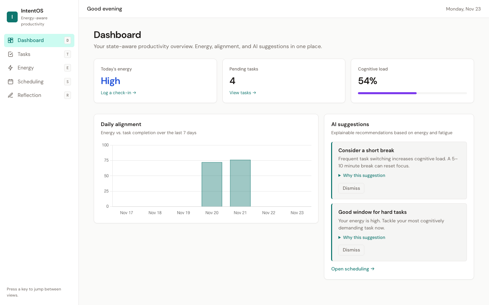
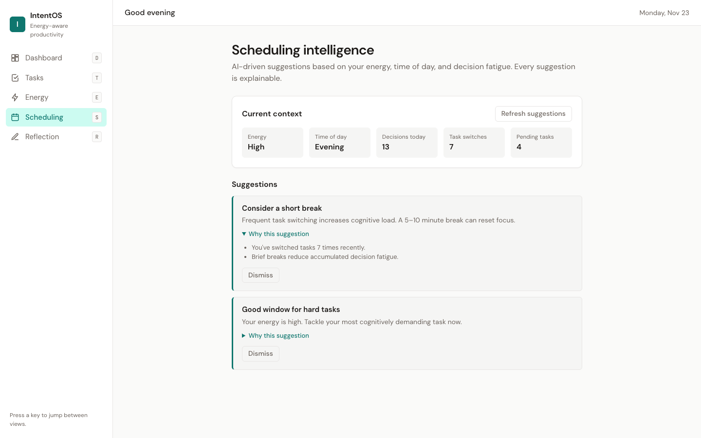
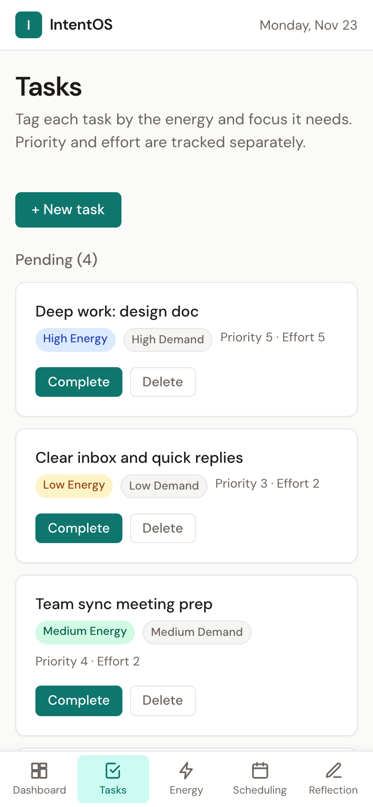
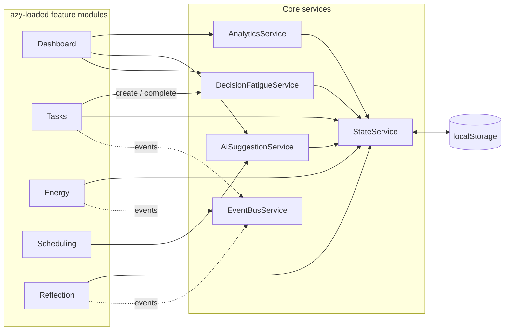

# IntentOS

An energy-aware productivity app: plan tasks around how you actually feel, get scheduling suggestions that explain themselves, and close the day with a short reflection.




| Explainable suggestions | Mobile layout |
| --- | --- |
|  |  |

## Features

- **Tasks**: tag each task with the energy it needs and its cognitive demand; priority and effort are tracked separately (1 to 5). Create, complete and delete.
- **Energy tracking**: log check-ins by time of day, with an optional note. A 14-day trend chart shows your average energy per day.
- **Scheduling suggestions**: a rule-based engine looks at current energy, time of day, decisions made today, task switches and pending work. Every suggestion carries a "Why this suggestion" list. Dismissed suggestions stay hidden for the rest of the day.
- **Decision fatigue**: creating and completing tasks counts as a decision; the dashboard turns decisions and task switches into a cognitive load score and short insights.
- **Reflection**: five end-of-day prompts (energy, focus, decisions, patterns, gratitude), today's entries and a 7-day count.
- **Dashboard**: today's energy, pending tasks, cognitive load, a 7-day energy-vs-completion chart and active suggestions.
- **Keyboard navigation**: `D`, `T`, `E`, `S`, `R` jump between views (ignored while typing in a field).
- Responsive layout: sidebar on desktop, bottom tab bar on phones.

There is no backend. All data lives in `localStorage`, and the app seeds a week of sample data on first launch so every screen has something to show. Clear site data in the browser to start over.

## Tech stack

| Area | Choice |
| --- | --- |
| Framework | Angular 21 (NgModules, lazy-loaded feature routes) |
| Language | TypeScript 5.9 in strict mode with strict templates |
| State | RxJS `BehaviorSubject` store persisted to `localStorage` |
| Charts | Chart.js 4 via ng2-charts |
| Styling | SCSS with CSS custom properties as design tokens |
| Tests | Jasmine + Karma (headless Chrome) |

## Architecture



- **StateService** is the single source of truth. Each slice (tasks, energy check-ins, decision summaries, suggestions, reflections) is a `BehaviorSubject` mirrored to `localStorage` through `StorageService`.
- **AiSuggestionService** is a deterministic rule engine, not a model. Each rule emits a title, a description and the `reasoning[]` that triggered it, for example "evening + low energy: defer high-focus work". Each run replaces the active set, so suggestions always reflect the current context.
- **DecisionFatigueService** counts decisions and task switches per day and derives a 0 to 100 cognitive load score.
- **AnalyticsService** computes the daily alignment score (energy vs. completion) and the energy trend.
- **GlobalErrorHandler** and **LoggingService** centralise error reporting and level-based logging.

The "AI" label is deliberate but honest: the suggestion layer is a set of readable rules, built so it could be swapped for a model-backed API without changing the UI contract.

## Getting started

Requirements: Node.js 20.19+, 22.12+ or 24, and npm.

```bash
git clone https://github.com/kashish14/AI-Augmented-Productivity-System.git
cd AI-Augmented-Productivity-System
npm ci
npm start
```

Open http://localhost:4200.

## Scripts

| Command | What it does |
| --- | --- |
| `npm start` | Dev server with live reload on port 4200 |
| `npm run build` | Production build to `dist/intent-os/browser` |
| `npm run watch` | Development build in watch mode |
| `npm test` | Karma in watch mode (opens Chrome) |
| `npm run test:ci` | Single headless test run, as used in CI |

## Project structure

```text
src/app/
├── core/            # models, services, seed data, date utils, error handler
├── layout/          # shell, header, sidebar / mobile tab bar
├── pages/dashboard/ # dashboard (lazy-loaded)
├── features/        # tasks, energy, scheduling, reflection (each lazy-loaded)
└── shared/          # SharedModule (CommonModule + RouterModule)
src/styles.scss      # design tokens and shared primitives (cards, buttons, forms, badges)
```

## Testing

```bash
npm run test:ci
```

The specs cover the suggestion engine (reasoning is present, no duplicates across runs, dismissals respected), decision-fatigue counting, the task list component and the local-date helpers. GitHub Actions runs install, build and tests on every push and pull request.

## Roadmap

- Model-backed suggestion API that returns structured reasoning
- Calendar integration so suggestions can target real free time
- Weekly pattern insights, such as your most focused hours
- JSON / CSV export of all local data

## License

[MIT](LICENSE) © 2026 Kashish Agarwal
